# Project 1: Active Directory Home Lab

## Overview

This project documents a home lab in which I built a small Windows domain from scratch. I installed and configured Active Directory Domain Services (AD DS), created users and groups, enforced security settings with Group Policy, shared files across the network, controlled storage with File Server Resource Manager (FSRM), and handed out IP addresses with DHCP.

The lab mirrors the day-to-day work of a first-line or second-line IT support technician in a small business: managing user accounts, applying company-wide settings, supporting shared drives, and troubleshooting basic network services.

> **Status:** the DNS section is still **to be completed** (see [DNS](#dns)).

### Key terms

| Term | Meaning |
|---|---|
| AD DS | Active Directory Domain Services: the directory that stores users, computers and groups |
| DC | Domain Controller: the server that runs AD DS |
| GPO | Group Policy Object: a set of settings pushed to users or computers |
| GPMC | Group Policy Management Console: the tool used to create and link GPOs |
| OU | Organizational Unit: a folder inside AD used to organise users and computers |
| FSRM | File Server Resource Manager: quotas and file screening on a file server |

## Lab environment

| Component | Details |
|---|---|
| Virtualisation | Virtual machines (hypervisor: Oracle VirtualBox) |
| Server VM | Windows Server 2022 Standard (evaluation), acts as the Domain Controller, DNS, DHCP and file server |
| Client VM | Windows 11 Enterprise (evaluation), joined to the domain |
| Domain name | `EastCharmer.local` |
| Organizational Units | `USA` OU with child OUs `Users`, `Computers` and `Servers` |
| Server IP address | Static: `<SERVER_IP>` |
| Subnet mask | `/24` (255.255.255.0) |
| Default gateway | `<GATEWAY_IP>` |

### Network diagram

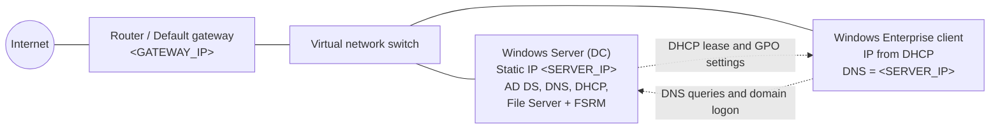

## Active Directory setup

### Preparing the server and client

1. Create a virtual machine with Windows installed.
2. Give the **server** a **static IP address** in the Ethernet adapter settings (open `ncpa.cpl` from a command prompt).
3. Run `ipconfig /all` to check the IP address, subnet mask and default gateway.
4. On the **client**, keep **DHCP enabled**, but set the **preferred DNS server** to the server's static IP address. The client needs this to find the domain.
5. Run `ping <SERVER_IP>` from the client to confirm the two machines can talk to each other.
6. On the **server**, set its own DNS server to `127.0.0.1` (itself), because the server also runs DNS.

### Installing AD DS and creating users and groups

- Install the Active Directory Domain Services role on the server and promote it to a Domain Controller.
- Use **Active Directory Users and Computers** to create users, groups and OUs (for example a *Users* OU).
- Join the client machine to the domain.

> The install and promotion steps are covered in "Installing Active Directory on Windows Server on a Virtual Machine (Home Lab)" (Ep. 1 of the video series I followed).

📸 *Screenshots to add:* `01-static-ip-server.png`, `02-ipconfig-all.png`, `03-client-dns-setting.png`, `04-ping-test.png`, `05-ad-users-and-computers.png`, `06-domain-join.png`

## Group Policies

All policies below follow the same first steps:

1. Open **Group Policy Management** (GPMC).
2. Create a **new GPO** under the domain (or the relevant OU).
3. **Edit** the GPO and set the options described below.

Group Policy has two halves: **Computer Configuration** (applies to the machine, whoever logs in) and **User Configuration** (applies to the user, wherever they log in).

### Password policy

**Path:** Computer Configuration → Policies → Windows Settings → Security Settings → Account Policies → Password Policy

Choose the setting you want (minimum length, complexity, maximum age and so on) and enable it.

> **Note:** domain account policies (password and lockout) only take effect when the GPO is linked at the **domain level**, for example in the Default Domain Policy.

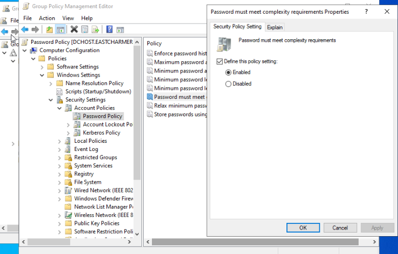

*In the lab, "Password must meet complexity requirements" is enabled.*

### Account lockout

**Path:** Computer Configuration → Policies → Windows Settings → Security Settings → Account Policies → Account Lockout Policy → **Account Lockout Threshold**

Set the number of failed sign-in attempts allowed before the account is locked. The purpose of this policy is to stop **brute-force and password-guessing attacks**.

**Recommended threshold: 5 to 10 attempts.**

- **Too low (1 to 3):** normal typing mistakes lock real users out, which creates a flood of help-desk tickets. An attacker can also lock out other people on purpose (a denial-of-service attack).
- **Too high (20+) or off:** an attacker can try thousands of passwords before anything stops them.
- **5 to 10** gives users room for honest mistakes while still making guessing attacks impractical.

The policy also lets you set the lockout duration and the time after which the failed-attempt counter resets.

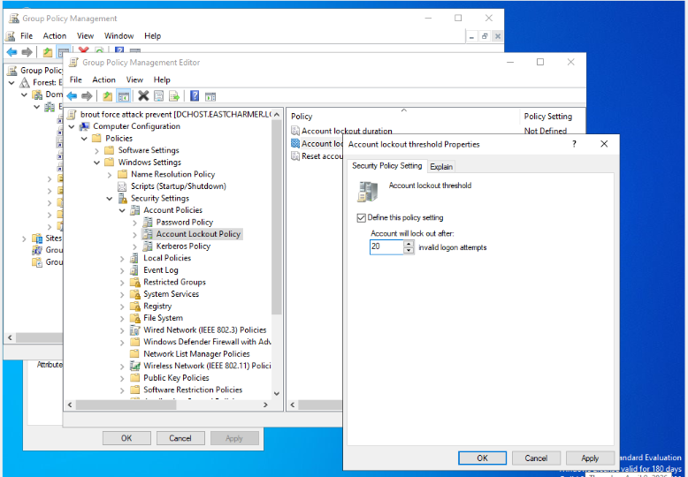

*In this lab test I set the threshold to **20** attempts. That is higher than my recommendation above, so in a real environment I would use 5 to 10.*

### Drive mapping (GPO)

**Path:** User Configuration → Preferences → Windows Settings → Drive Maps → New → Mapped Drive

Select the shared folder (UNC path, for example `\\SERVER\Shared`) and assign a drive letter. The drive appears automatically for every user the GPO applies to. See [File sharing](#file-sharing-manual-vs-gpo-mapping).

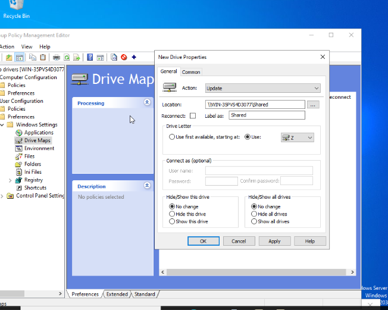

*The GPO maps `\\WIN-35PVS4D3077\Shared` to drive **Z:** with the label "Shared".*

### Default wallpaper

**Path:** User Configuration → Policies → Administrative Templates → Desktop → Desktop → **Desktop Wallpaper**

Enable the policy and enter the path to the wallpaper image. Use a **UNC path** so that every client can reach the file over the network, for example:

```
\\SERVER\Shared\wallpaper.jpg
```

A local path such as `C:\wallpaper.jpg` would only work if the file existed on every client PC. Make sure users have at least **read** permission on the share. Then click **Apply** and **OK**.


*The policy is enabled with the style set to **Fill**. In this test the path was a local file; for a real deployment, replace it with the UNC path shown above.*

### Control Panel restriction

**Example goal:** stop standard users from opening the Control Panel.

**Path:** User Configuration → Policies → Administrative Templates → Control Panel → **Prohibit access to Control Panel and PC settings**

Enable the policy, then **link the GPO to the Users OU** in Group Policy Management.

#### Applying the policy

On the client PC, open a terminal and run:

```
gpupdate /force
```

This forces the client to download Group Policy immediately instead of waiting for the normal refresh cycle (about 90 minutes). Some user settings need the user to sign out and back in. The client can no longer open the Control Panel.

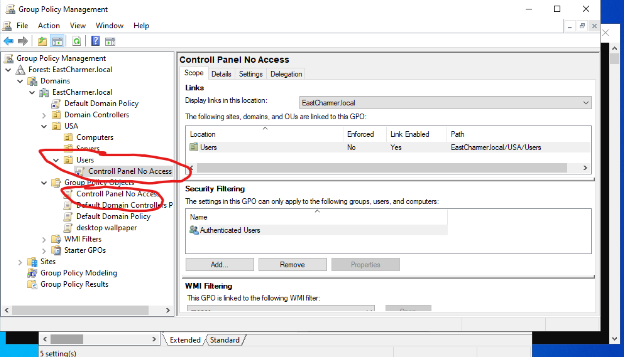

*The GPO is linked to the `EastCharmer.local/USA/Users` OU.*

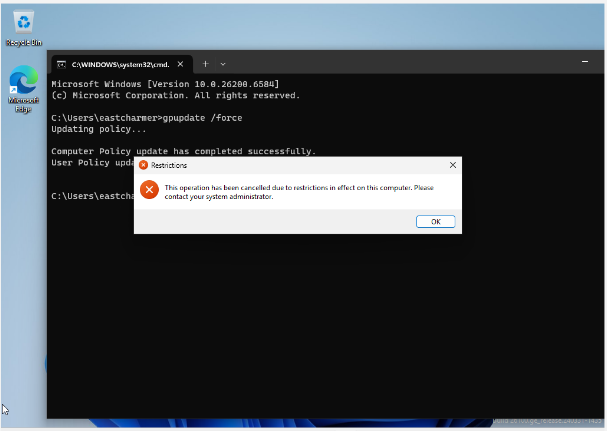

*After `gpupdate /force`, the client shows "This operation has been cancelled due to restrictions in effect on this computer."*

## File sharing (manual vs GPO mapping)

### Creating the shared folder (both methods)

1. On the DC, open the C: drive and create a new folder (for example `Shared`).
2. Right-click it → **Properties** → **Sharing** tab → **Share**.
3. Give the correct group the access it needs. In this lab, the **Domain Users** group has **Read** permission on the share. Use **Change** for any group that must save files.

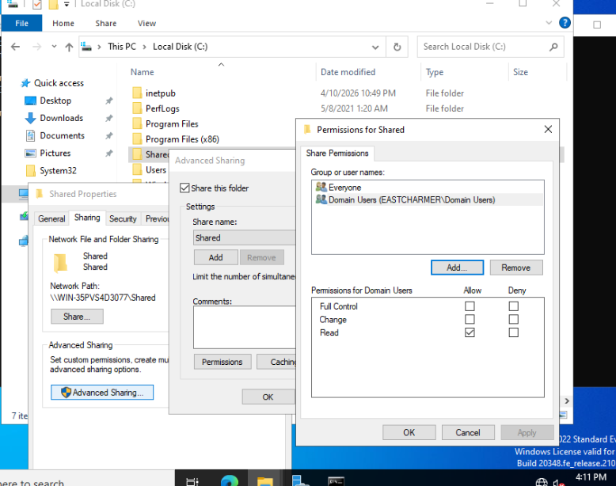

### Method 1: Manual mapping (per user, per PC)

1. On the client, open **File Explorer** → **This PC**.
2. Right-click and choose **Map network drive**.
3. Enter the UNC path: `\\HOSTNAME\Shared`.
4. Tick **Reconnect at sign-in** if you want the drive to come back after a restart.

> **Persistence:** a manually mapped drive **is persistent only if "Reconnect at sign-in" is ticked**. If it is not ticked, the drive disappears at the next sign-out or restart.

**Best for:** quick, one-off access on a single PC. It has to be repeated on every machine.

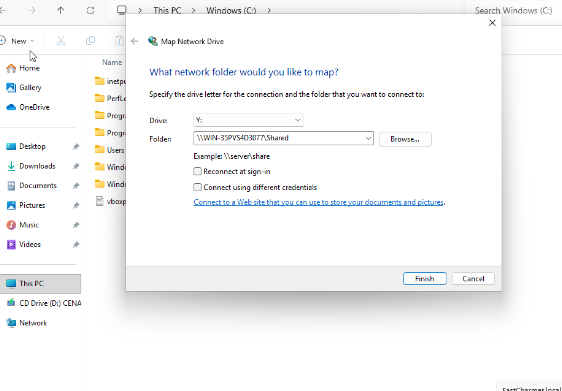

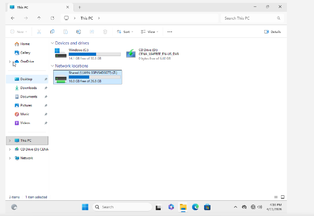

### Method 2: GPO mapping (automatic, for all users)

1. Configure the Drive Maps preference described in [Drive mapping (GPO)](#drive-mapping-gpo).
2. On the client, run `gpupdate /force`, then sign out and back in (or restart).
3. The shared drive appears in File Explorer automatically.

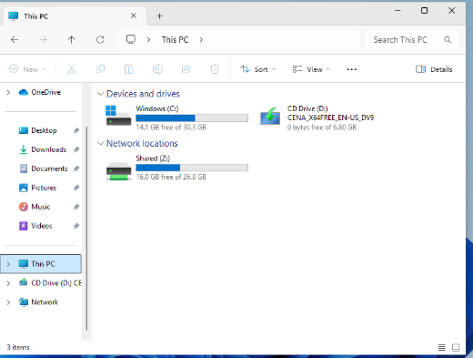

**Best for:** many users, because it is set up once and managed centrally.

| | Manual mapping | GPO mapping |
|---|---|---|
| Set up where | On each client | Once, on the DC |
| Persistent | Only with "Reconnect at sign-in" | Yes, applied at every sign-in |
| Scales to many users | No | Yes |
| Central control | No | Yes |

## FSRM quotas and file screening

**File Server Resource Manager (FSRM)** controls what is stored in shared folders and how much.

### Installing FSRM

In **Server Manager**, use *Add Roles and Features* and select **File Server Resource Manager** (under File and Storage Services). Then launch *File Server Resource Manager*.

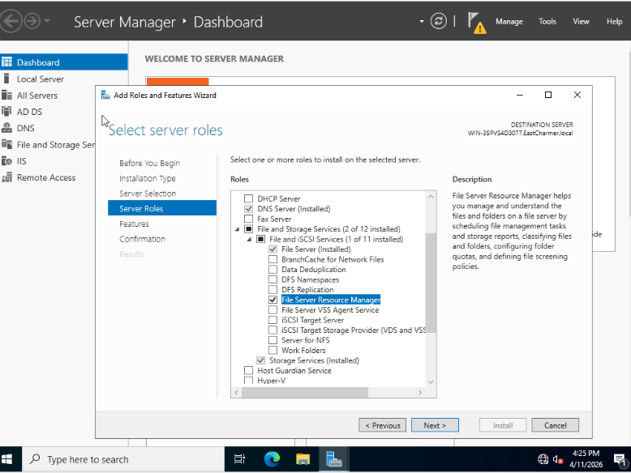

### Quota management

Create a **Quota Template** to limit the size of the shared folder, then apply it to the folder. In this lab, `C:\Shared` has a **100 MB hard quota** (users cannot go over it), with a warning notification at 80%.

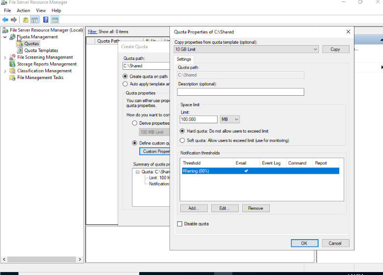

### File screening

Create a **File Screen** with custom properties to block unwanted file types. In this lab the screen blocks:

- images
- executable files
- videos (audio and video files)

The screen uses **active screening**, so users cannot save these file types in the Shared folder.

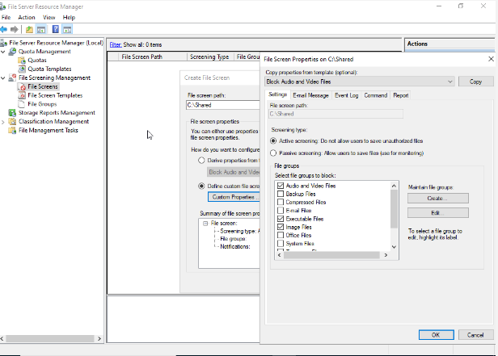

As a result, users can no longer add these file types to the Shared folder. The active file screen is listed in FSRM, and Windows shows an access-denied message when a blocked file is copied in:

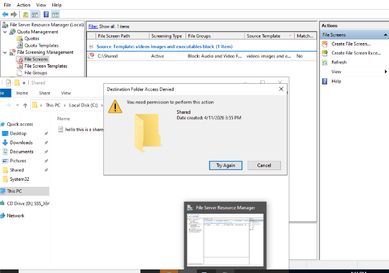

## DHCP

1. In **Server Manager**, use *Add Roles and Features* and select **DHCP Server**.
2. If a warning says the PC has no static IP address, configure one using `ncpa.cpl`, restart, and then install the role.
3. After installation, click **Configure credentials** and then **Commit** (this authorises the DHCP server in Active Directory).
4. In Server Manager choose **Tools → DHCP**. In the DHCP manager, select **IPv4**.
5. Choose **Add scope** (New Scope) and click through the wizard, entering the relevant information.
6. **Activate the scope.**

### Planning the address range

With a **/24** subnet mask (255.255.255.0), the network has 2⁸ = 256 addresses. Two are reserved (the network address and the broadcast address), which leaves **254 usable host addresses**.

A common convention is to keep the first block of addresses (for example `.1` to `.99`) **static** for devices whose address must not change, such as the router, printers and Windows servers, and to let DHCP hand out the rest (for example `.100` to `.254`).

| Item | Value |
|---|---|
| Scope range | `<START_IP>` to `<END_IP>` |
| Exclusions | `<EXCLUDED_RANGE>` |
| Router (default gateway) | `<GATEWAY_IP>` |
| DNS server | `<SERVER_IP>` |

📸 *Screenshots to add:* `21-dhcp-role-install.png`, `22-dhcp-new-scope.png`, `23-dhcp-scope-active.png`

## DNS

> 🚧 **To be completed.** My notes stop at "Installing DNS server". The steps below are only what I have documented so far.

What is already configured (see [Active Directory setup](#active-directory-setup)):

- The server uses `127.0.0.1` as its own DNS server.
- The client uses the server's static IP address as its DNS server.
- In **DNS Manager** (opened from Server Manager), under the `EastCharmer.local` zone, a new **A** (IPv4) or **AAAA** (IPv6) record was added with an **empty name** (same as the parent folder) and the IP address of the DC.

Still to document:

- [ ] Installing and verifying the DNS Server role
- [ ] Forward lookup zone settings
- [ ] Reverse lookup zone
- [ ] Testing with `nslookup`

📸 *Screenshots to add:* `24-dns-manager.png`, `25-dns-a-record.png`, `26-nslookup-test.png`

## Skills demonstrated

- Installing and configuring **Active Directory Domain Services**
- Creating and managing **users, groups and OUs**
- Writing and linking **Group Policy Objects**: password policy, account lockout, drive mapping, wallpaper and Control Panel restriction
- Understanding the difference between Computer and User configuration, and Policies and Preferences
- Forcing policy refresh with `gpupdate /force`
- Creating **network shares** and setting share permissions
- Comparing manual drive mapping with automated GPO drive mapping
- Using **FSRM** quotas and file screens to manage storage
- Installing and configuring a **DHCP** server and scope
- Subnetting basics (/24, usable hosts, static vs dynamic ranges)
- Configuring static IPs and DNS settings; using `ipconfig /all`, `ping` and `ncpa.cpl` for troubleshooting
- Documenting a technical project clearly

---

## Screenshot checklist

All images are in the [`screenshots/`](screenshots/) folder.

| # | File name | What it shows | Status |
|---|---|---|---|
| 1 | `01-static-ip-server.png` | Server Ethernet IPv4 properties with the static IP | To add |
| 2 | `02-ipconfig-all.png` | `ipconfig /all` output | To add |
| 3 | `03-client-dns-setting.png` | Client DNS pointing to the server IP | To add |
| 4 | `04-ping-test.png` | Successful ping to the server | To add |
| 5 | `05-ad-users-and-computers.png` | Users, groups and OUs | To add |
| 6 | `06-domain-join.png` | Client joined to the domain | To add |
| 7 | `07-gpo-password-policy.png` | Password Policy: complexity enabled | Added |
| 8 | `08-gpo-account-lockout.png` | Account Lockout Threshold | Added |
| 9 | `09-gpo-drive-map.png` | Drive Maps preference | Added |
| 10 | `10-gpo-wallpaper.png` | Desktop Wallpaper policy | Added |
| 11 | `11-gpo-control-panel-policy.png` | Control Panel GPO linked to the Users OU | Added |
| 12 | `12-control-panel-blocked.png` | Restriction message on the client | Added |
| 13 | `13-share-permissions.png` | Share permissions window | Added |
| 14 | `14-map-network-drive.png` | Map network drive dialog | Added |
| 15 | `15-manual-mapped-drive.png` | Manually mapped drive in File Explorer | Added |
| 16 | `16-gpo-mapped-drive.png` | GPO-mapped drive in File Explorer | Added |
| 17 | `17-fsrm-role-install.png` | FSRM role selected in the wizard | Added |
| 18 | `18-fsrm-quota.png` | 100 MB hard quota on `C:\Shared` | Added |
| 19 | `19-fsrm-file-screen.png` | File screen blocking audio/video, executable and image files | Added |
| 20 | `20-file-blocked-in-share.png` | Active file screen and access-denied message | Added |
| 21 | `21-dhcp-role-install.png` | DHCP role installed | To add |
| 22 | `22-dhcp-new-scope.png` | New scope wizard | To add |
| 23 | `23-dhcp-scope-active.png` | Active scope | To add |
| 24 | `24-dns-manager.png` | DNS Manager | To add |
| 25 | `25-dns-a-record.png` | A record for the DC | To add |
| 26 | `26-nslookup-test.png` | `nslookup` result | To add |

> No passwords, tokens or real personal data should appear in any screenshot. Blur or replace them before saving.