# Project 2: IT Help Desk in Jira Service Management

## Overview

In this project I built a small IT help desk for a fictional company, **Firma GmbH**, using the free plan of **Jira Service Management (JSM)**. I set up request types, priorities and SLAs (service level agreements), imported 20 realistic practice tickets, and wrote a ticket template and five knowledge base articles in plain language.

The tickets are fake. Eight of them are based on problems from my [Active Directory home lab](../project-1-ad-lab/README.md), so I can reproduce and fix them myself.

> **Status:** the help desk is set up and the tickets are imported. The 12 general tickets (HELP-9 to HELP-20) are resolved, each with resolution notes. The 8 lab tickets (HELP-1 to HELP-8) are **still open**, because they need my Active Directory lab to be rebuilt first.

## What I built

| Part | Details |
|---|---|
| Tool | Jira Service Management (free plan), service space `HELP` |
| Request types | Password reset, Access request, Hardware, Software, Network problem |
| Priorities | P1 (critical) to P4 (low), P5 unused |
| SLAs | First response and resolution goals per priority (see below) |
| Calendar | 24/7, so the SLA hours are easy to check |
| Tickets | 20 practice tickets, imported from a CSV file |
| Knowledge base | 5 short articles in [`kb-articles/`](kb-articles/) |
| Template | [`ticket-template.md`](ticket-template.md) for resolution notes |

### Request types

Request types are the forms that users pick when they ask for help. I created five and described when to use each one.

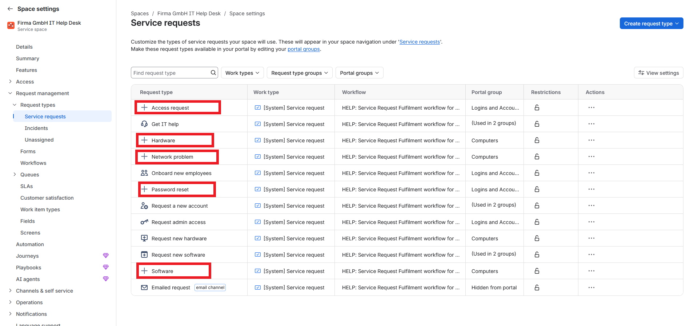

*The five request types I created are highlighted. The others come from the Atlassian template.*

### Priorities

I renamed Jira's default priorities to a P1 to P4 scheme that most IT teams know.

| Priority | Meaning |
|---|---|
| P1 | Critical: many users or a whole service is down |
| P2 | High: one user or an important function is blocked |
| P3 | Normal: work is slowed down, there is a workaround |
| P4 | Low: small request or cosmetic problem |

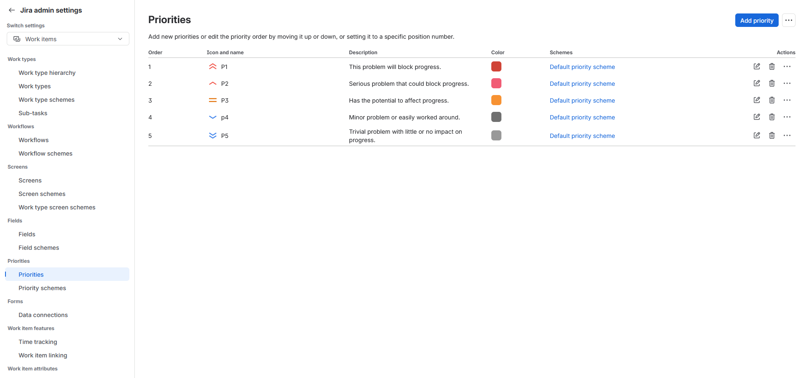

### SLAs

An SLA is a promise about how fast the help desk responds and resolves.

| Priority | Respond within | Resolve within |
|---|---|---|
| P1 | 1 hour | 4 hours |
| P2 | 4 hours | 8 hours |
| P3 | 8 hours | 3 days (72 h) |
| P4 | 1 day | 5 days (120 h) |

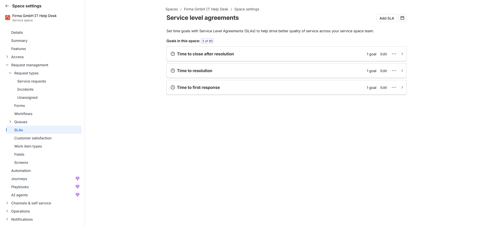

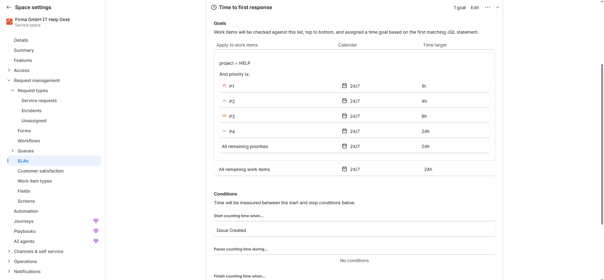

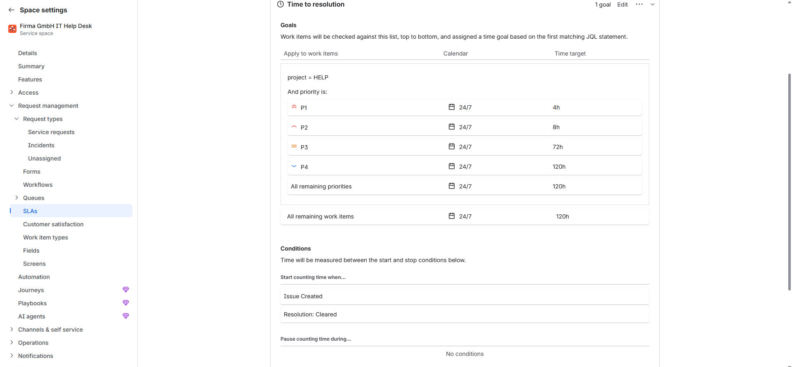

**Calendar:** I used a 24/7 calendar, so "72 hours" means three full days. A real company would usually use an office-hours calendar (for example Monday to Friday, 08:00 to 17:00).

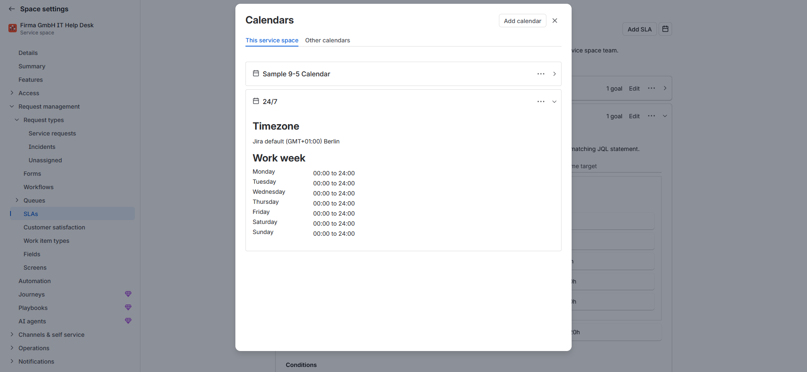

**Checking the SLAs:** after the import, the due times shown on the tickets matched the table. For example, a P1 ticket created at 20:09 was due at 00:09 the next day (4 hours), and a P3 ticket was due three days later.

## Importing the tickets

I imported [`tickets.csv`](tickets.csv) with Jira's CSV importer. The file has five columns: Summary, Description, Request Type, Priority and Reporter.

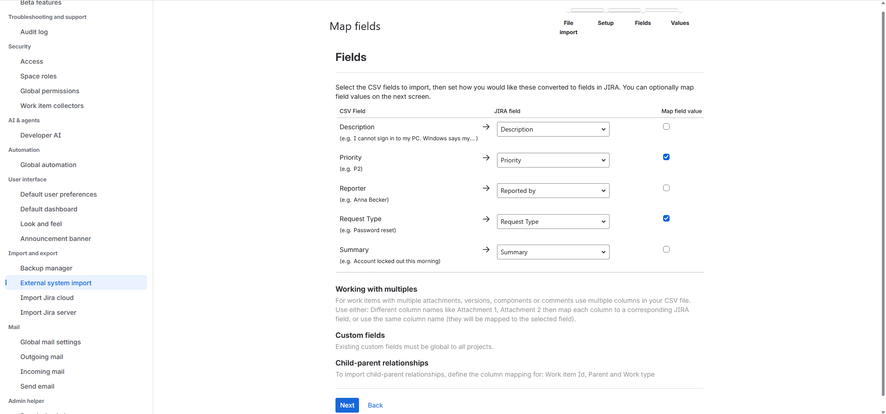

**Problems I found and how I handled them**

| Problem | What I did |
|---|---|
| The reporters are fake people, and Jira only accepts real user accounts as reporters | I created a text field called "Reported by" and mapped the Reporter column to it |
| The import finished with 20 warnings: Jira could not set the request type from the CSV ("value was in incorrect format") | I checked the result and set the request type on each ticket afterwards |
| The template's old SLA goals used priority names that no longer existed after my rename | I rewrote the goals with P1 to P4 and removed the broken filter |

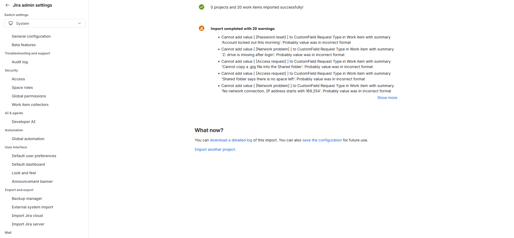

### The ticket queue

Top of the queue:

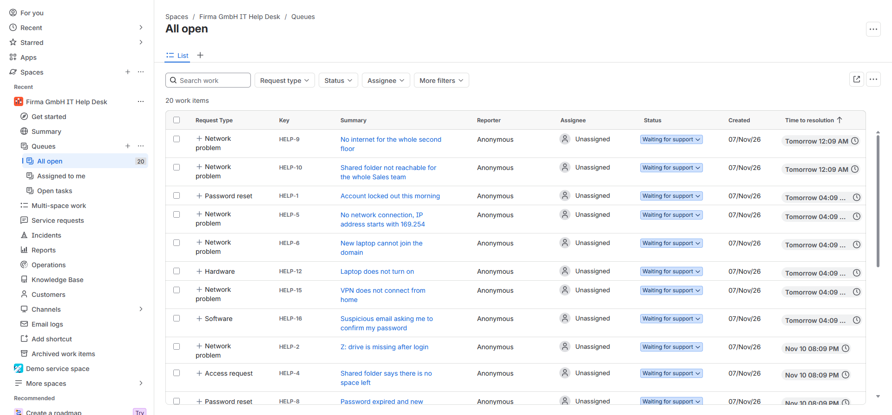

Bottom of the queue:

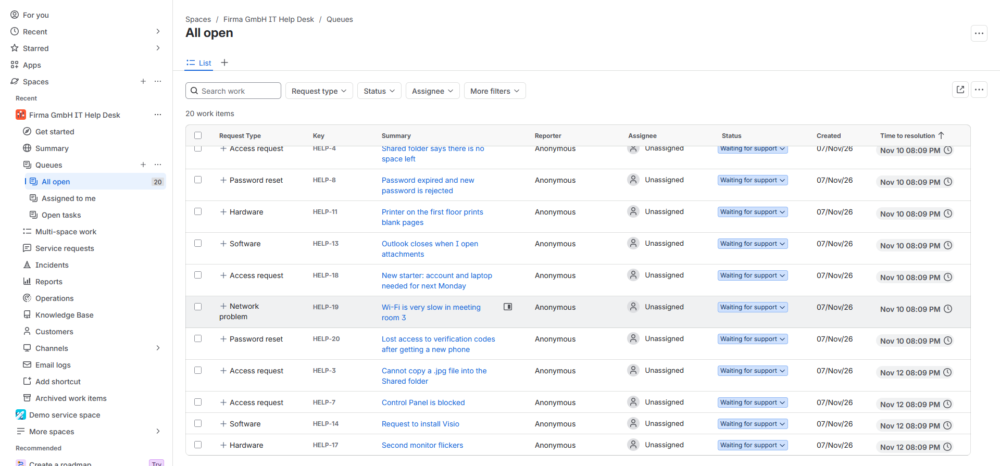

### An open ticket with its SLA timers

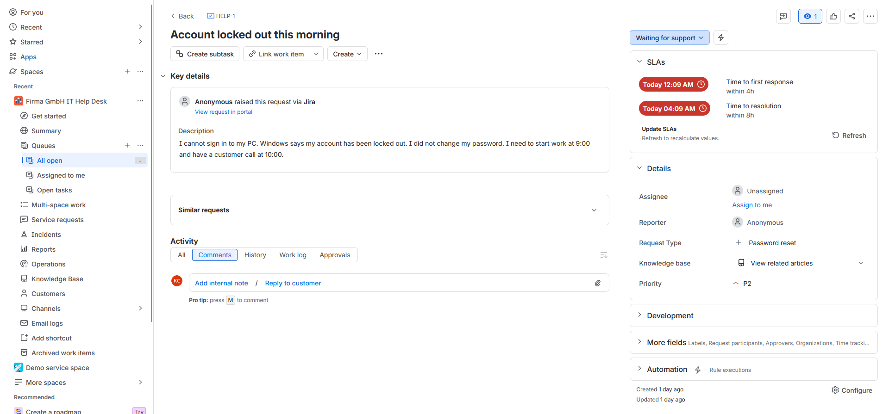

*HELP-1 shows the request type (Password reset), the priority (P2) and the two SLA timers: first response within 4 hours and resolution within 8 hours. The timers are red because the due times have passed while the practice ticket was waiting.*

## The 20 practice tickets

Tickets marked **Lab** are based on my Active Directory home lab.

| Key | Summary | Request type | Priority | Source |
|---|---|---|---|---|
| HELP-1 | Account locked out this morning | Password reset | P2 | Lab |
| HELP-2 | Z: drive is missing after login | Network problem | P3 | Lab |
| HELP-3 | Cannot copy a .jpg file into the Shared folder | Access request | P4 | Lab |
| HELP-4 | Shared folder says there is no space left | Access request | P3 | Lab |
| HELP-5 | No network connection, IP address starts with 169.254 | Network problem | P2 | Lab |
| HELP-6 | New laptop cannot join the domain | Network problem | P2 | Lab |
| HELP-7 | Control Panel is blocked | Access request | P4 | Lab |
| HELP-8 | Password expired and new password is rejected | Password reset | P3 | Lab |
| HELP-9 | No internet for the whole second floor | Network problem | P1 | General |
| HELP-10 | Shared folder not reachable for the whole Sales team | Network problem | P1 | General |
| HELP-11 | Printer on the first floor prints blank pages | Hardware | P3 | General |
| HELP-12 | Laptop does not turn on | Hardware | P2 | General |
| HELP-13 | Outlook closes when I open attachments | Software | P3 | General |
| HELP-14 | Request to install Visio | Software | P4 | General |
| HELP-15 | VPN does not connect from home | Network problem | P2 | General |
| HELP-16 | Suspicious email asking me to confirm my password | Software | P2 | General |
| HELP-17 | Second monitor flickers | Hardware | P4 | General |
| HELP-18 | New starter: account and laptop needed for next Monday | Access request | P3 | General |
| HELP-19 | Wi-Fi is very slow in meeting room 3 | Network problem | P3 | General |
| HELP-20 | Lost access to verification codes after getting a new phone | Password reset | P3 | General |

## Resolution notes

I write my resolution notes with [`ticket-template.md`](ticket-template.md): summary, troubleshooting steps, root cause, resolution, time spent and a link to a knowledge base article.

**Resolved tickets:** HELP-9 to HELP-20 (the 12 general tickets). The notes are in the ticket comments in Jira, and a copy is in [`resolution-drafts/`](resolution-drafts/).

The tickets are fictional, so the root causes in these notes are **assumed** scenarios, and the notes say so. They show how I would troubleshoot and document each type of problem. No time spent is recorded, because no real work time was measured.

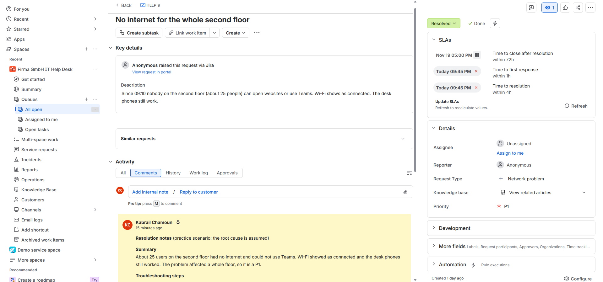

*HELP-9 (P1, Network problem) after resolution: the status is Resolved, and the resolution note is saved as an internal note. The SLA timers show as breached, because they kept running while the practice ticket waited.*

**Still open:** HELP-1 to HELP-8 (the lab tickets). I will resolve them after rebuilding the lab, so their notes will come from real tests with real screenshots.

## Knowledge base articles

Short articles in plain language for end users:

- [Reset or change your password](kb-articles/reset-your-password.md)
- [Connect a network drive](kb-articles/connect-a-network-drive.md)
- [Why can't I save this file type?](kb-articles/why-cant-i-save-this-file-type.md)
- [Check your network connection](kb-articles/check-your-network-connection.md)
- [What to do with a phishing email](kb-articles/what-to-do-with-a-phishing-email.md)

## Skills demonstrated

- Setting up a service desk in **Jira Service Management**: request types, priorities, SLAs and calendars
- Designing **SLAs** and checking that the timers match the targets
- Importing data with a **CSV file**, mapping fields, and fixing import problems
- Prioritising tickets on a P1 to P4 scale
- Writing clear **ticket descriptions** and **resolution notes**
- Writing **knowledge base articles** for non-technical users
- Linking help desk tickets to a hands-on lab (Active Directory, Group Policy, DHCP, DNS, FSRM)

## Files in this project

| File | Purpose |
|---|---|
| [`tickets.csv`](tickets.csv) | The 20 practice tickets, ready for import |
| [`setup-guide.md`](setup-guide.md) | Step-by-step instructions for building this help desk |
| [`ticket-template.md`](ticket-template.md) | Template for resolution notes |
| [`kb-articles/`](kb-articles/) | Five knowledge base articles |
| [`screenshots/`](screenshots/) | Screenshots of the finished setup |

> All names, tickets and companies in this project are fictional. No real personal data is included.
